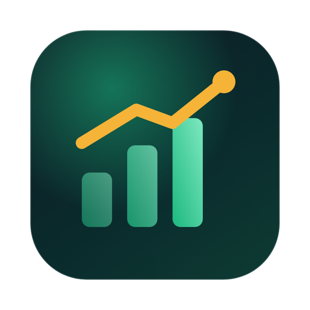
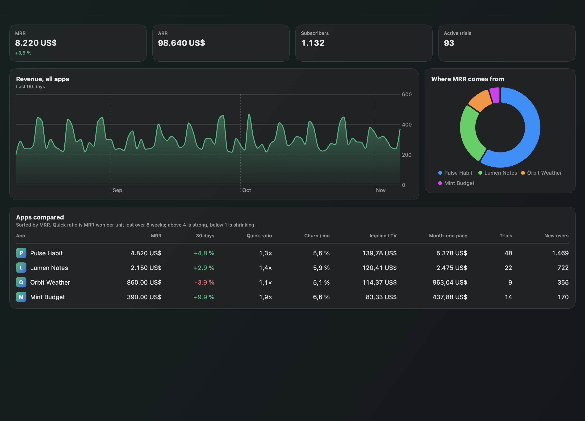
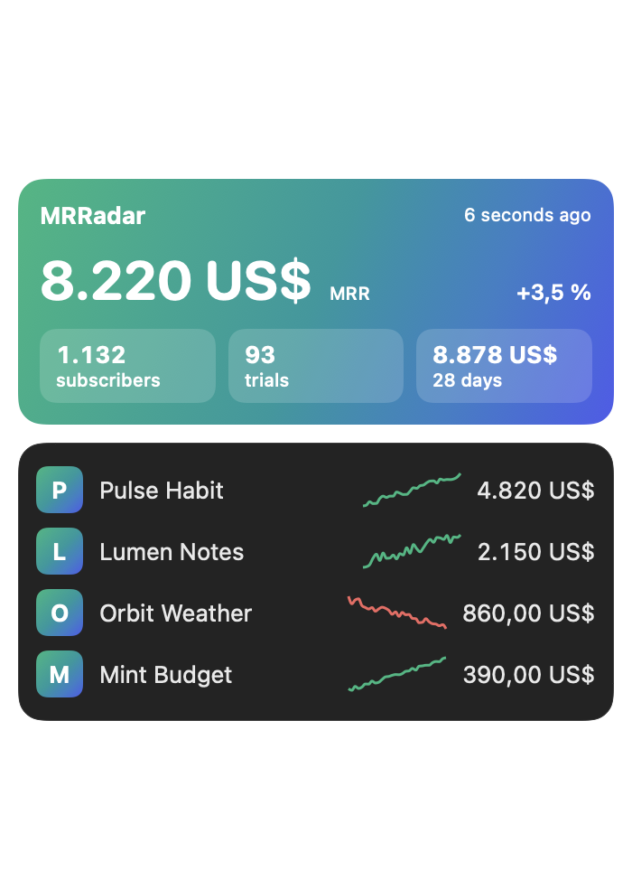
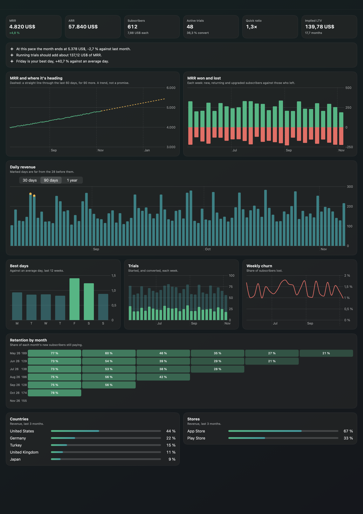

<p align="center"></p>

<h1 align="center">MRRadar</h1>

<p align="center">Your subscription apps on one radar: menu bar analytics, forecasts and alerts for everything you run on RevenueCat.</p>

<p align="center"><a href="README.tr.md">Türkçe</a></p>

<p align="center"></p>

The RevenueCat dashboard shows one project at a time. MRRadar puts all of them side by side and works out what no single chart shows. It is a free, open-source, native Mac app. It has no server and no account of its own.

> Screenshots use MRRadar's made-up demo apps. MRRadar is not affiliated with or endorsed by RevenueCat.

## Features

**Every app at once**
* Total MRR, ARR, subscribers and trials, added up per currency and never across currencies
* One table comparing MRR, 30-day change, quick ratio, churn, implied LTV and month-end pace

**Numbers worked out for you**
* **MRR forecast:** a straight line through the last 60 days, drawn 90 days ahead, with no promise attached
* **Month-end pace:** where this month lands at the pace of the last 14 days
* **Quick ratio:** MRR won per unit lost over 8 weeks
* **Implied LTV and lifetime:** from MRR per subscriber and monthly churn
* **Trial pipeline:** the MRR that running trials should add at your real conversion rate
* **Unusual days:** revenue that stands out from the 28 days before it
* **Best weekdays,** a monthly **retention heatmap,** and revenue by **country** and **store**

**Alerts**
* New subscribers, falling MRR, MRR milestones, unusual days, high refunds and rising churn
* Notifications on your Mac, with your own thresholds
* On your iPhone and iPad through [Remote Code](https://github.com/ardasnturk/remote-code)

<p align="center"></p>

<p align="center"></p>

## Install

Download the DMG from the [latest release](https://github.com/ardasnturk/mrradar/releases/latest), or use Homebrew:

```sh
brew tap ardasnturk/mrradar https://github.com/ardasnturk/mrradar
brew install --cask mrradar
```

MRRadar needs macOS 15 or newer and a RevenueCat account.

## Setup

MRRadar opens once these steps are done:

1. **RevenueCat CLI.** MRRadar reads your data through `rc`, RevenueCat's official open-source CLI. If it's missing, MRRadar installs it with Homebrew, or from the official release after checking the published checksum.
2. **Sign in.** Your browser opens RevenueCat and `rc` keeps the sign-in. You can use a REST API v2 secret key instead, with read access to charts and projects. MRRadar stores that key in your Keychain.
3. **Your apps.** Pick the projects to follow.
4. **Notifications.** Optional.

If `rc` disappears or the sign-in expires, MRRadar returns to that step.

## How it works

RevenueCat allows 25 chart requests a minute, so MRRadar paces itself: headline numbers every 15 minutes, full charts every 6 hours, both adjustable. The first full report takes about half a minute per app. Everything is cached in `~/Library/Application Support/MRRadar`.

MRRadar only reads. It has no way to refund, grant or change anything in your account.

Your data goes between your Mac and RevenueCat, through `rc`. Project icons load from the address RevenueCat gives. MRRadar has no analytics and makes no other requests, apart from the GitHub download during setup if `rc` needs installing.

## Remote Code

[Remote Code](https://github.com/ardasnturk/remote-code) brings MRRadar to your iPhone and iPad as a tab, with alerts. It starts MRRadar's hub when the app isn't open. The hub listens on `127.0.0.1` only, and its token is in a `0600` file. See [docs/HUB_API.md](docs/HUB_API.md).

## Try it without an account

```sh
open -a MRRadar --args --demo
```

## Building from source

```sh
brew install xcodegen
xcodegen generate
open MRRadar.xcodeproj
```

Tests: `swift test --package-path RadarKit`. Translations live in `scripts/l10n/source.py`; see [CONTRIBUTING.md](CONTRIBUTING.md).

## License

[MIT](LICENSE). RevenueCat is a trademark of its owner.
