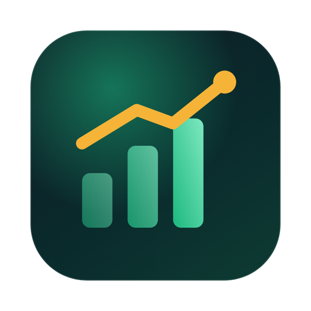
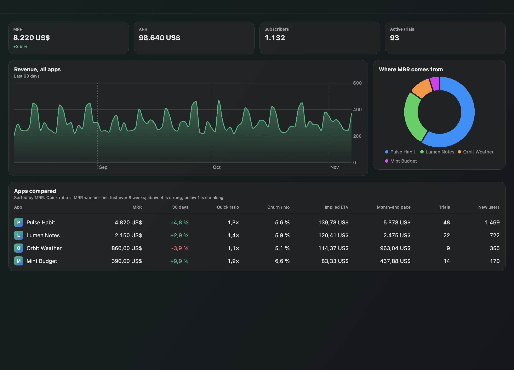

<p align="center"></p>

<h1 align="center">MRRadar</h1>

<p align="center">Abonelik uygulamalarınız tek radarda: RevenueCat'teki her şey için menü çubuğunda analiz, tahmin ve uyarı.</p>

<p align="center"><a href="README.md">English</a></p>

<p align="center"></p>

RevenueCat paneli projeleri tek tek gösterir. MRRadar hepsini yan yana koyar ve tek bir grafikte görünmeyen rakamları hesaplar. Ücretsiz, açık kaynaklı ve native bir Mac uygulamasıdır; sunucusu ve kendi hesabı yoktur.

> Görseller MRRadar'ın uydurma demo uygulamalarıyla alınmıştır. MRRadar'ın RevenueCat ile bir bağlantısı yoktur.

## Özellikler

* Tüm uygulamalar için toplam MRR, ARR, abone ve deneme sayısı (para birimine göre, para birimleri toplanmaz)
* MRR, 30 günlük değişim, quick ratio, churn, tahmini LTV ve ay sonu hızını karşılaştıran tablo
* MRR tahmini, ay sonu hızı, quick ratio, tahmini LTV ve abone ömrü
* Devam eden denemelerin getireceği MRR, olağandışı günler, en iyi günler
* Aylık retention ısı haritası, ülke ve mağaza dağılımı
* Yeni aboneler, düşen MRR, MRR eşikleri, olağandışı günler, yüksek iade ve artan churn için uyarılar
* Mac bildirimleri; [Remote Code](https://github.com/ardasnturk/remote-code) ile iPhone ve iPad'de de

## Kurulum

DMG'yi [son sürümden](https://github.com/ardasnturk/mrradar/releases/latest) indirin ya da Homebrew kullanın:

```sh
brew tap ardasnturk/mrradar https://github.com/ardasnturk/mrradar
brew install --cask mrradar
```

macOS 15 veya üstü ve bir RevenueCat hesabı gerekir. Uygulama şu adımlardan sonra açılır:

1. **RevenueCat CLI:** yoksa MRRadar `rc`'yi Homebrew ile ya da sağlama toplamını doğrulayarak resmi sürümden kurar.
2. **Giriş:** tarayıcıda RevenueCat açılır, girişi `rc` saklar. İsterseniz REST API v2 gizli anahtarı kullanabilirsiniz; anahtar Anahtar Zinciri'nde tutulur.
3. **Uygulamalar:** izlenecek projeleri seçersiniz.
4. **Bildirimler:** isteğe bağlıdır.

MRRadar yalnızca okur; hesabınızda iade yapamaz, hiçbir şeyi değiştiremez. Analitik içermez. Verileriniz yalnızca Mac'iniz ile RevenueCat arasında dolaşır.

## Lisans

[MIT](LICENSE). RevenueCat, sahibinin ticari markasıdır.
